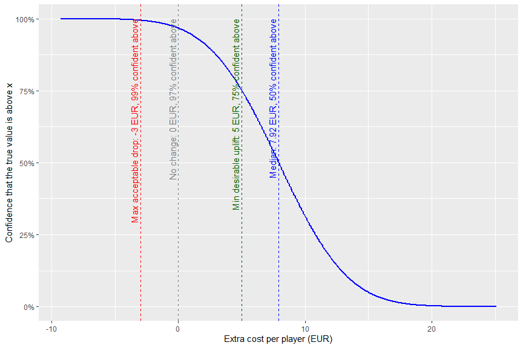

# About

This is not a move to a different system. The numbers are the same ones the current system produces. Only the reporting changes: instead of an interval, we show the confidence that the true uplift is above a given value.

# Inputs


``` r
# Greece, full cost per player (EUR), 1-22 Nov, as reported by the current system
est <- 7.92
lo  <- -0.51   # 95% interval, lower
hi  <- 16.34   # 95% interval, upper
p   <- 0.066   # reported p-value

max_drop   <- -3   # maximum acceptable drop (EUR)
min_uplift <-  5   # minimum desirable uplift (EUR)
```

# Self-consistency check

The estimate, interval and p-value reported by the current system should agree with each other under the normal approximation. If they do not, the curve built from the interval will not match the reported p-value.


``` r
mid   <- (lo + hi) / 2
se    <- (hi - lo) / (2 * qnorm(0.975))
z     <- mid / se
p_int <- 2 * pnorm(-abs(z))

data.frame(
  quantity = c("estimate", "p-value"),
  reported = c(est, p),
  from_interval = c(mid, p_int)
)
```

```
##   quantity reported from_interval
## 1 estimate    7.920    7.91500000
## 2  p-value    0.066    0.06557478
```

# Curve


``` r
x     <- seq(mid - 4 * se, mid + 4 * se, length.out = 500)
curve <- data.frame(x = x, conf = 1 - pnorm(x, mid, se))

marks <- data.frame(
  name = c("Max acceptable drop", "No change", "Min desirable uplift", "Median"),
  x    = c(max_drop, 0, min_uplift, mid)
)
marks$conf  <- 1 - pnorm(marks$x, mid, se)
marks$label <- sprintf("%s: %.3g EUR, %.0f%% confident above", marks$name, marks$x, 100 * marks$conf)

cols <- c("Max acceptable drop" = "red", "No change" = "grey50", "Min desirable uplift" = "darkgreen", "Median" = "blue")

ggplot(curve, aes(x, conf)) +
  geom_line(linewidth = 1, colour = "blue") +
  geom_vline(data = marks, aes(xintercept = x, colour = name), linetype = "dashed") +
  geom_text(data = marks, aes(x = x, y = 1, label = label, colour = name),
            angle = 90, hjust = 1, vjust = -0.4, show.legend = FALSE) +
  scale_colour_manual(values = cols, guide = "none") +
  scale_y_continuous(labels = scales::percent, limits = c(0, 1)) +
  labs(x = "Extra cost per player (EUR)",
       y = "Confidence that the true value is above x")
```

<!-- -->

# How to read it

